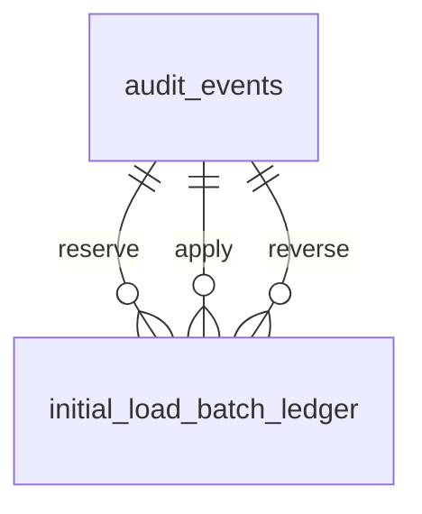

# Registro de cambio de datos #694 — ledger de lote de carga inicial (fase Q)

**Identificación y estado:** 24-10-2026 (Chile); ChatGPT; issue #694; PR #721, rama `feature/initial-load-batch-ledger-694-20261024-gpt`; base inicial `dev@b4ce7e9319667ca954c14edf616f8086b721ad38`. Estado: código en PR, NO desplegado; completar SHA de integración y gates en cierre. Regla PMGM-GOV-004, índice PMGM-DB-004. Registros previos relacionados: PR #713 (bloqueo bootstrap), PR #715/#716 (ventana atómica) y PR #720 (política pura de idempotencia). Alcance exclusivamente nueva tabla `core.initial_load_batch_ledger` y mapeo EF; se excluyen datos personales, contratos HTTP, cuentas, perfiles y archivos CSV.

## Diccionario físico de la entidad

Cada fila describe una propiedad persistida nueva, registrada en `Entities/InitialLoadBatchLedger.cs`, `BootstrapDbContext.cs` y migración `20261025220000_AddInitialLoadBatchLedger`. Clasificación propuesta de TODOS los campos: **`internal`** (siguiendo el vocabulario de `docs/seguridad/PMGM-DATA-CLASSIFICATION-BOOTSTRAP.json`, estado `engineering_baseline_pending_legal_review`), con exposición más restrictiva: `allowInLogs=false`, `allowExport=false`, `publicProjection=false`, `masking=authorized_platform_view_only`, `owner=Administración de Plataforma` y retención referida al código existente `RET-AUDIT-SECURITY` sin fijar plazos nuevos. La asignación detallada campo por campo al manifiesto de clasificación **queda pendiente de revisión**, no se declara aprobada. Acceso futuro solo al Máster/servicio de auditoría autorizado; no publicación en UI pública ni logs. La huella HMAC, aunque no sea un RUT ni SHA público, puede correlacionar lotes: tratarla como restringida, no como información anónima certificada.

| Campo funcional / SQL | Finalidad | Tipo SQL | Nullable / default | Validación / catálogo |
|---|---|---|---|---|
| Huella privada de lote / `Fingerprint` | Identidad de lote estable contra reintentos | varchar(64), PK | NO / sin default | `^[a-f0-9]{64}$`, HMAC del contenido CSV verificado; nunca calcular SHA simple de RUT/correo |
| Estado de lote / `Status` | Paso de ciclo de vida | varchar(16) | NO / sin default SQL | `pending`, `applied`, `reversed` |
| Versión / `Version` | Control concurrencia/transiciones | bigint | NO / sin default SQL | pending=0; applied=1; reversed=2 |
| Auditoría de reserva / `ReservedAuditEventId` | Relación inmutable del acto de reserva | uuid, FK | NO / sin default | Debe existir en `core.audit_events.Id` |
| Auditoría de aplicación / `AppliedAuditEventId` | Referencia del acto de aplicar | uuid, FK | SÍ / NULL | Nulo hasta applied; distinto a reserva; inmutable tras aplicado |
| Auditoría de reversión / `ReversedAuditEventId` | Referencia de acto de reversión | uuid, FK | SÍ / NULL | Solo en reversed; distinto a ambas referencias anteriores |
| Fecha de reserva / `CreatedAtUtc` | Instante inicial del ledger | timestamptz | NO / sin default SQL | UTC; inmutable tras insertar |
| Última actualización / `UpdatedAtUtc` | Última transición | timestamptz | NO / sin default SQL | No anterior a CreatedAtUtc ni a marca de fase; monótono |
| Aplicado en / `AppliedAtUtc` | Instante de aplicación | timestamptz | SÍ / NULL | Solo en applied/reversed; no anterior a CreatedAtUtc; inmutable al revertir |
| Revertido en / `ReversedAtUtc` | Instante de reversión | timestamptz | SÍ / NULL | Solo en reversed; no anterior a AppliedAtUtc |

No hay columnas calculadas ni datos reales en la migración. Defaults del objeto C# NO son defaults SQL ni autorizan crear registros desde HTTP.

## Estructura, relaciones y controles verificables

| Origen | PK/índice | FK / cardinalidad | Integridad / borrado |
|---|---|---|---|
| `core.initial_load_batch_ledger` | PK única `Fingerprint`; índices sobre los 3 IDs de auditoría | 3 FK individuales `*AuditEventId` → `core.audit_events.Id`; muchos lotes pueden referenciar un evento según FK (unicidad de evento por lote **no está garantizada por BD**) | `ON DELETE RESTRICT` de cada FK; trigger del ledger prohíbe DELETE y TRUNCATE de lotes |
| `core.audit_events` (existente) | PK `Id`; fuera del alcance de cambio | Un evento puede ser referenciado por varias filas según SQL; un lote tiene 1 auditoría reserva y 0/1 aplicación y 0/1 reversión | No se cambia el esquema ni los triggers previos de auditoría |

**CHECK** exige coincidencia estricta estado/versión/timestamps/auditorías; huella hex 64 minúsculas. **Trigger** permite únicamente INSERT pending/0, UPDATE pending→applied→reversed en versión +1, inmutabilidad de la huella y prueba de reserva, conservación de prueba aplicada al revertir; prohíbe DELETE, TRUNCATE y reapertura. **PK** rechaza dos reservas simultáneas de misma huella. Por seguridad, esto NO equivale a un servicio de apply ni a prueba jurídica.

## Antes/después y compatibilidad

| Elemento | Antes (`dev`) | Después (PR #721) | Riesgo/impacto |
|---|---|---|---|
| Identificación de lote | Política pura PR #720, sin ledger persistido | Huella HMAC única por PK SQL | La clave de HMAC debe custodiarse y versionarse externamente. Rotarla sin reconciliar produce huellas diferentes. |
| Ciclo de vida de lote | Plan lógico `pending/applied/reversed` | CHECK + trigger transaccional de terminalidad | La integridad adicional es exigible aun si el llamador omite validación de aplicación. |
| Prueba de acciones | Sin referencias persistidas del lote | Tres FK a `audit_events`, timestamps | Alta de lote requiere auditoría previa en **misma transacción** futura; ninguna aquí ejecuta cargas. |
| Esquema EF | `BootstrapDbContext` sin `InitialLoadBatchLedgers` | Nueva entidad, DbSet y mapeo; `Version` concurrency token | Sin cambiar contratos API, frontend, reportes ni cuentas. |

**Migración:** `backend/src/PMGM.Api/Migrations/20261025220000_AddInitialLoadBatchLedger.cs` (`BootstrapDbContext`), nueva tabla vacía, restricciones, función y triggers; no backfill ni transformación de otras entidades. `Down` elimina tabla y registros (riesgo de pérdida histórica): **NO ejecutarlo en datos reales sin plan de preservación, aprobación operativa y respaldos**. Mantener backups y prueba de recuperación. No inventar política de retención ni eliminar auditorías. Instalación en QA física y UAT NO realizadas por este PR.

**Verificación:** `Integration/InitialLoadBatchLedgerPostgreSqlTests.cs` registra un lote simulado dentro de transacción que revierte, valida PK duplicada SQLSTATE 23505, FK ausente 23503, pending→applied→reversed, rechazo de reapertura/borrado 55000 y readback 0 filas/0 auditorías. Añadida a shard a solo una vez en `.github/backend-integration-shards.json`. CI/Showcase/QA Installable exact-head y SHA final deben consignarse en issue #694, PR y Drive al cerrar. Datos reales y endpoint apply excluidos.

**Seguridad y gobierno:** la institución determina bases jurídicas/finalidades fuera del sistema; el backend ejecuta controles técnicos y auditoría. No se considera aprobación jurídica ni habilitación de importar personas. `main` no se promueve; no se interviene glmdch. Responsables de revisión: Sponsor e integradores del proyecto; pendiente validación UAT operativa.
